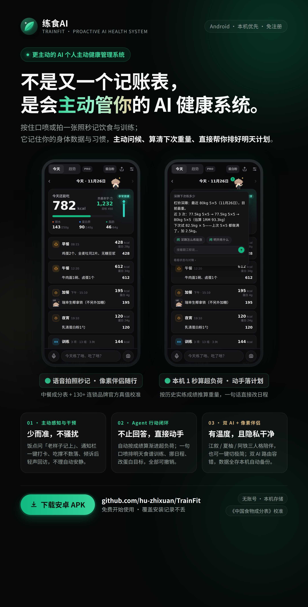
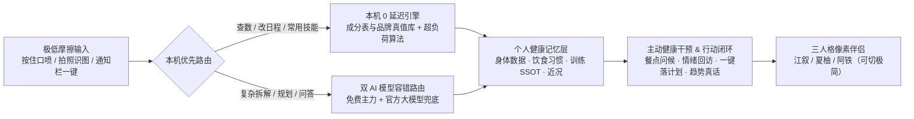
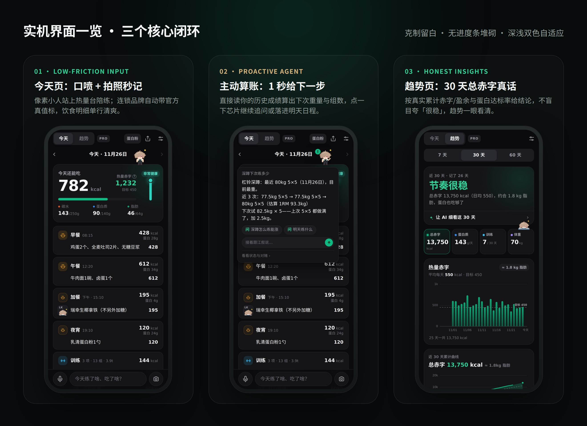

# 练食AI · TrainFit

**更主动的 AI 个人主动健康管理系统**  
*不是又一个要你搜表填克数的热量记账本，是一套会主动找你、会动手排计划的个人健康 Agent。*

  
  
  

  <a href="https://github.com/hu-zhixuan/TrainFit/releases/latest"><b>📥 下载最新安卓 APK</b></a>
  &nbsp;·&nbsp;
  <a href="#-实机界面一览"><b>📱 实机界面</b></a>
  &nbsp;·&nbsp;
  <a href="#-为什么做主动健康管理系统"><b>🧠 系统架构</b></a>
  &nbsp;·&nbsp;
  <a href="https://github.com/hu-zhixuan/TrainFit/issues/new/choose"><b>💬 提建议 / 报 Bug</b></a>

 

---

## 📥 立即下载（仅 Android）

- **GitHub Releases（推荐，始终最新）**：前往 [**Releases Latest**](https://github.com/hu-zhixuan/TrainFit/releases/latest)，点开下方 **Assets** 下载 `TrainFit-v版本号.apk`。
- **国内备用直链（蓝奏云）**：[下载 `v16.18` 安卓安装包](https://wwbfi.lanzn.com/isV4O4h9rk7a)（提取码：`3are`）。
- **覆盖更新**：以后出新版本直接覆盖安装，本地历史记录、习惯记忆与训练计划全部保留。

---

## 🧠 为什么做「主动健康管理系统」

传统健身和热量 App 大多是**被动表单**：每顿饭搜食材、挑克数，训练和饮食拆成两个软件，记三天嫌烦就弃了。  
**练食AI** 不只是套壳大模型聊天，而是包在大模型外层的一套 **Personal Health Agent Harness（个人主动健康管理层）**——把**极低摩擦记录、营养与训练校准、长期个人记忆、低打扰主动干预与直接行动执行**串成一个闭环。

| 维度 | 传统被动记录 App | 练食AI（主动健康管理系统） |
|---|---|---|
| **记录方式** | 逐项搜索食材、手动选克数和训练动作 | **单入口按住口喷语音 / 拍一张照**，一句话同时记早中晚、训练与体重 |
| **系统主动性** | 你不打开它，它什么都不做；断更就弹焦虑红字 | **少而准的主动找你**：餐点问「老样子记上」、通知一键记、情绪与近况轻声回访，不理自动安静 |
| **给建议 vs 动手做** | 泛泛而谈的科普文章或模板计划 | **读取你自己的真实记录直接动手**：算下次渐进超负荷重量、一键排明天食谱训练、口喷改日程且可撤销 |
| **情绪体验** | 冰冷红字报超标，越记越有负罪感 | **吃多不数落、不用红字愧疚感**；三位独立人格像素小人陪伴，也可一键切极简零打扰 |

### 系统工作流（Agent Harness）

---

## ✨ 核心能力

### 1. 会主动找你的健康管家（少而准，绝不骚扰）
- **节点主动接话**：早上提醒称体重，午晚饭点空着会用你常吃的饭问一句「还是老样子？」，通知栏点一下直接记上，不用进 App 翻界面。
- **记得你发生过的事**：记完大餐或破纪录实时接话（吃多不数落，只说明天怎么温和拉回）；聊到加班、考试、情绪低落时，隔几小时会按角色口吻轻声回访一次。
- **严格防打扰边界**：每天主动打招呼有硬上限，连着两条没理白天就不再追，几天没来自动保持安静；不想要陪伴也能随时切**极简模式**或隐藏小人。

### 2. 不止回答问题，能直接替你动手（Agentic Loop）
- **渐进超负荷自动算**：所有同动作别名自动归并，记录同步回写计划库；问「深蹲下次练多少」手机 1 秒直接按你的历史实练给出下次重量与次数（区分正式组与热身/极限单次）。
- **一句话直接改日程与目标**：问「明天吃什么」「明天练什么」生成按你预算配平的食谱与带重量的训练表，点一下落地进日程；直接口喷「把明天的计划挪到后天」「蛋白目标改成 140g」「今天练计划 A」秒执行且支持撤销。
- **本机快答 + 健康大脑**：常规查数（「还差多少蛋白」「还能吃多少」「卧推最好多少」）0 延迟本机直出；营养、恢复、伤病与饮食搭配问题自动结合你近两周的真实记录作答。

### 3. 语音 + 拍照极低摩擦输入，中餐和连锁店算得准
- **双段语音识别 + 拍照秒记**：说话时手机本机 SenseVoice 边说边出字，联网同步走云端实时精校；懒得开口直接拍一顿饭或包装营养表。
- **多源校准不瞎估**：单一食材按《中国食物成分表（第 6 版）》与 USDA 校准；近 60 道家常中餐按菜谱算清烹调油；内置 **130+ 连锁品牌官方营养库**（麦当劳、肯德基、瑞幸、霸王茶姬等），支持「两个水煮蛋只吃一个蛋黄」「不另外加糖」「不喝汤」精细拆解，点一下气泡就能只调甜度、油量或生熟重。

### 4. 三位独立人格像素小人（也可一键纯净极简）
- **江叙**（慢热克制、留白感）、**夏柚**（鲜活护短、不发嗲）、**阿铁**（实在烟火气铁哥们）三位完全独立的人格，名字可自定义。
- 站上热量台陪练、支持今天页与趋势页自由拎起抛接和 2D 实体碰撞（丢多了还会冒「💢」生闷气，长按摸头哄好）。
- 偏好纯粹极客工具？设置里一键切**极简模式**或关闭小人，界面立刻回归安静的单按钮记录仪。

### 5. 趋势页说真话 + 蛋白粉比价
- **30 / 60 天总赤字一眼看清**：趋势页按真实累计赤字/盈余与蛋白达标率给结论，吃超了实话实说，不再盲目夸「节奏很稳」；单卡极简排布，无冗余进度条堆砌。
- **蛋白粉性价比榜**：按「每克纯蛋白到手价」客观排序，支持品牌筛选与口碑查看。

---

## 📱 实机界面一览

  

---

## ⚙️ 安卓安装说明

1. 使用手机浏览器打开 [**Releases Latest**](https://github.com/hu-zhixuan/TrainFit/releases/latest)（或上方蓝奏云备用链），下载 `TrainFit-v版本号.apk`。
2. 点开 APK 安装；首次安装如系统提示「允许安装未知来源应用」，按提示允许即可。
3. 打开后按引导一句话或填表建档，即可开始按住说话或拍照使用。

> 目前仅提供 Android 版，暂未上架应用商店、无 iOS / 小程序版。

---

  © 2026 练食AI (TrainFit) · 保留所有权利 · <a href="https://github.com/hu-zhixuan/TrainFit/releases">全部版本更新日志</a>

